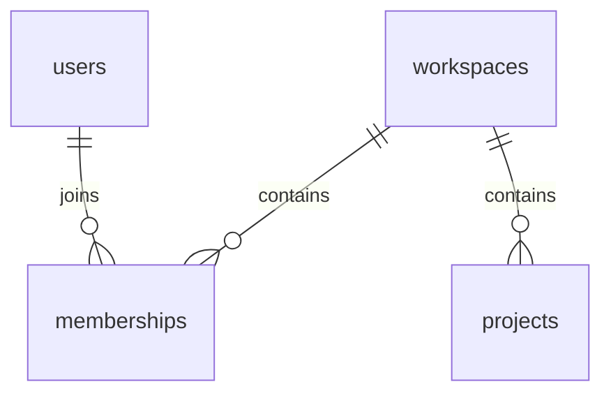

# Local database

Run these commands from the DocWeave root. Docker Desktop must be running with its Linux engine available. Python 3.12+, uv, and Docker Compose are required. In this workspace uv is available at `C:/Users/acer/AppData/Local/Temp/docweave-test-tools/bin/uv.exe`; if it is absent from PATH, use that executable in place of `uv` below.

## Credentials and services

The initial setup created an ignored root `.env` with random local passwords. Preserve it when restarting an existing database. For a fresh checkout, copy `.env.example` to `.env` only if `.env` does not exist, replace the three placeholder passwords with distinct URL-safe random values, and update the matching connection URLs. Neither real passwords nor database URLs belong in committed files or command output.

| Service | Address | Storage |
| --- | --- | --- |
| Development `db` | `127.0.0.1:55432/docweave` | Persistent `docweave_pgdata` named volume |
| Disposable `test-db` | `127.0.0.1:55433/docweave_test` | tmpfs; data is discarded when the container stops |

Both use `pgvector/pgvector:0.8.7-pg17`, pinned to digest `sha256:ac08538c6f8b9904c33c8224c5e5706dbe760aca29db1d096972b4052c22a75d`. The administrator bootstraps the extension and `app` schema. `docweave_migrator` owns migration tables; `docweave_runtime` has SELECT-only access to the four domain tables, with no schema-creation, role-switching, write, or RLS-bypass authority. Administrator credentials are used only by the database container/bootstrap. Runtime code selects only its requested URL and does not export Compose credentials into the process environment.

```powershell
uv sync --project backend --locked
docker compose config --quiet
docker compose up -d --wait db
uv run --project backend --locked alembic -c backend/alembic.ini upgrade head
uv run --project backend --locked alembic -c backend/alembic.ini current
uv run --project backend --locked alembic -c backend/alembic.ini check
```

Expected revision is `0009_retrieval (head)`; `alembic check` should report no new application-model upgrades. Migrations use `MIGRATION_DATABASE_URL`; runtime uses `DATABASE_URL`. Bootstrap provisions the distinct worker login and migration-owned `queue` schema required before 0008; startup does not migrate. 0009 adds private searchable pointers, immutable generations and scoped chunks, with transaction-local generation RLS and atomic replacement activation. See [ingestion](ingestion.md) for worker/storage/parser setup and [retrieval](retrieval.md) for scope/metrics; application model comparison excludes dependency-owned queue tables. Broader domains remain reserved and readiness stays 503. Existing development credentials/volumes must be preserved.

Bootstrap runs only for an empty PostgreSQL data directory. Changing `.env` passwords does not rotate existing database-role passwords. Preserve the environment file and volume; credential rotation must update roles and configuration together. Do not recreate development storage to work around an authentication failure.

On 2026-10-31 the user explicitly approved [development login repair](../../backend/infra/postgres/repair-development-logins.sql). It was first checked on the guarded disposable service. Private database/login backups were saved under ignored `backups/`, original application row counts stayed unchanged, all three restricted logins authenticated, and the preserved development volume reached `0009_retrieval`. The queue is installed and empty. The repair is an operator recovery action, never an automatic startup step; password variables must be supplied privately through stdin, never command-line values or committed files.

## Schema and session boundary

The `app` schema contains users, workspaces, memberships, and projects. Issuer/subject identifies a user; duplicate emails do not merge identities. Memberships have a composite workspace/user primary key and an owner/maintainer/member role check. Projects hold their workspace, goal, JSONB stack array, optional context text, and a positive context revision. Keys are UUIDs, timestamps are timezone-aware, and foreign keys use restrictive deletion.



Use `tenant_session(engine, actor_id=..., workspace_id=...)` only with IDs obtained from trusted identity/policy code. It applies parameter-bound transaction-local settings and commits or rolls back on exit. These settings do not authenticate a caller. RLS permits only the actor's own user row, including before joining a workspace; membership and workspace/project rows remain scoped by actor membership. Missing actor context returns no rows; missing membership never grants workspace/project access. Owner/migrator connections bypass ordinary table-owner RLS and are never API credentials. Auth adds CRUD only on `auth_flows`, `auth_sessions`, `auth_rate_limits` and EXECUTE on a fixed-search-path identity-provisioning function. General domain write grants and business authorization remain deferred.

`0003_workspaces` adds narrow atomic creation/own-workspace listing and a membership-user index. `0004_memberships` adds private invitation storage and fixed-search-path owner/recipient functions. `0005_projects` adds default collections, private pending-documentation requests and narrow context functions; its preflight stops safely on nonempty legacy stacks for operator review. `0006_collection_policy` adds revisioned private grants/approval tables and immutable operator processor metadata. Collection RLS now allows current owners or granted members in the selected workspace; write capability also checks role. Membership triggers remove/downgrade grants and advance revisions. Composite foreign keys prevent cross-tenant associations. Narrow functions recheck ownership after workspace waits; policy reads use one snapshot. General domain writes, private approval/request reads and unselected tenant reads remain restricted. Processor metadata is globally readable but contains no credentials. Stored stacks/processor registrations are not proof of version approval/model availability. Budget admission, import workers, conversations, model calls and deletion workflows remain future work.

## Tests

`0007_budget` adds immutable versioned profile metadata, private monthly workspace allowances and a private reservation ledger with generated conservative charges. Narrow runtime functions serialize reserve/settle and operator-only cap changes using the same advisory lock. Usage reads use one snapshot and return only authorized aggregates. General financial DML/raw reads remain denied; profile metadata contains no secrets and is globally readable. Profiles default empty/disabled; no real pricing/account/capability claim is inferred from migrations. The guarded disposable fixture names ledger/profile tables explicitly for TRUNCATE without CASCADE so immutable test metadata can reset; this is never application behavior. Downgrade drops financial history/configuration and requires a production backup/recovery plan.

```powershell
docker compose --profile test up -d --wait test-db
uv run --project backend --locked pytest backend/tests -q -W error
```

The suite includes API/contract, OIDC/session and database checks. Database tests perform migrations, downgrade/re-upgrade, seed/clear synthetic rows, and verify constraints/privileges on the disposable instance. They require `TEST_DATABASE_URL` and `TEST_MIGRATION_DATABASE_URL`, allow only query-free URLs targeting exactly `127.0.0.1:55433/docweave_test`, require distinct role logins and reject development targets. Missing configuration fails clearly. Run the backend suite serially because these fixtures share a disposable schema.

To run only the API/contract checks without a database:

```powershell
uv run --project backend --locked pytest backend/tests/test_api.py backend/tests/test_health.py backend/tests/test_openapi.py -q
```

Tests cover actual restricted logins, denied cross-tenant/no-context reads, required membership, rollback, pooled connection reuse after commit and rollback, refused DML/DDL/role switching/RLS bypass, vector availability, identity uniqueness, named checks and foreign keys. They do not establish complete application authentication or authorization. Windows sandbox execution may need local-loopback permission for Python's internal event-loop sockets.

## Stop and recover

```powershell
docker compose stop db
docker compose --profile test stop test-db
```

Stopping development preserves its named volume; restarting uses `docker compose up -d --wait db`. Stopping the test service discards only its temporary data; the next test start bootstraps a fresh cluster. Do not use volume deletion, factory reset, or prune as a routine setup/recovery step.

If PostgreSQL is unavailable, inspect `docker compose ps` and `docker compose logs --tail 40 db`. A schema mismatch requires an explicit migration; connectivity is not proof that migrations are current. Development rollback can destroy data and is not a routine recovery command. Downgrade validation belongs only on the disposable test database.

One verified failure walkthrough: the first downgrade failed because user/workspace RLS policies referenced memberships. The migration now removes the policies before dropping tables, and downgrade/re-upgrade is covered by a passing integration test. A second regression test caught query-string connection overrides in the test-target guard; query parameters are now rejected before any migration or row cleanup.
