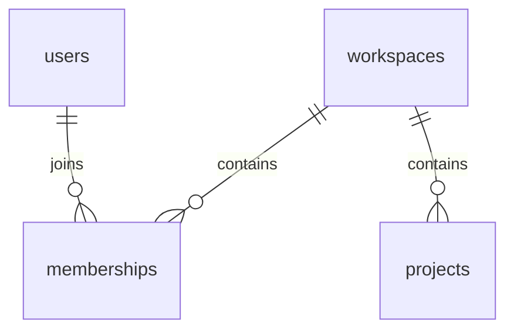

# Local database

Run these commands from the DocWeave root. Docker Desktop must be running with its Linux engine available. Python 3.12+, uv, and Docker Compose are required. In this workspace uv is available at `C:/Users/acer/AppData/Local/Temp/docweave-test-tools/bin/uv.exe`; if it is absent from PATH, use that executable in place of `uv` below.

## Credentials and services

The initial setup created an ignored root `.env` with random local passwords. Preserve it when restarting an existing database. For a fresh checkout, copy `.env.example` to `.env` only if `.env` does not exist, replace the three placeholder passwords with distinct URL-safe random values, and update the matching connection URLs. Neither real passwords nor database URLs belong in committed files or command output.

| Service | Address | Storage |
| --- | --- | --- |
| Development `db` | `127.0.0.1:55432/docweave` | Persistent `docweave_pgdata` named volume |
| Disposable `test-db` | `127.0.0.1:55433/docweave_test` | tmpfs; data is discarded when the container stops |

Both use `pgvector/pgvector:0.8.7-pg17`, pinned to digest `sha256:ac08538c6f8b9904c33c8224c5e5706dbe760aca29db1d096972b4052c22a75d`. The administrator bootstraps the extension and `app` schema. `docweave_migrator` owns migration tables; `docweave_runtime` has SELECT-only access to the four domain tables, with no schema-creation, role-switching, write, or RLS-bypass authority. Administrator credentials are used only by the database container/bootstrap. Runtime code selects only its requested URL and does not export Compose credentials into the process environment.

```powershell
uv sync --project backend --locked
docker compose config --quiet
docker compose up -d --wait db
uv run --project backend --locked alembic -c backend/alembic.ini upgrade head
uv run --project backend --locked alembic -c backend/alembic.ini current
uv run --project backend --locked alembic -c backend/alembic.ini check
```

Expected revision is `0001_core (head)`; `alembic check` should report no new upgrade operations. Migrations use `MIGRATION_DATABASE_URL`; runtime sessions use `DATABASE_URL`. API startup does not connect, create tables, or migrate automatically. Existing feature operations remain 501 and application readiness remains 503.

Bootstrap runs only for an empty PostgreSQL data directory. Changing `.env` passwords does not rotate existing database-role passwords. Preserve the environment file and volume; credential rotation must update roles and configuration together. Do not recreate development storage to work around an authentication failure.

## Schema and session boundary

The `app` schema contains users, workspaces, memberships, and projects. Issuer/subject identifies a user; duplicate emails do not merge identities. Memberships have a composite workspace/user primary key and an owner/maintainer/member role check. Projects hold their workspace, goal, JSONB stack array, optional context text, and a positive context revision. Keys are UUIDs, timestamps are timezone-aware, and foreign keys use restrictive deletion.



Use `tenant_session(engine, actor_id=..., workspace_id=...)` from the database module only with IDs obtained from trusted identity/policy code. It applies parameter-bound actor/workspace settings inside one transaction and commits or rolls back on exit. These settings do not authenticate a caller. RLS limits the runtime role to the actor's own user/membership and a workspace/project set for which that actor has membership. Missing context or missing membership yields no rows. Owner/migrator connections intentionally bypass ordinary table-owner RLS; they are never runtime API credentials. Application write grants and business authorization remain deferred.

The stored stack is an array of metadata, not proof that dependency/version review has occurred. No collections, sessions, invitations, jobs, conversation data, provider calls, deletion workflows, or last-owner rules are implemented by this schema.

## Tests

```powershell
docker compose --profile test up -d --wait test-db
uv run --project backend --locked pytest backend/tests -q -W error
```

The suite currently has 196 checks: 145 API/contract checks and 51 database checks. Database tests perform migrations, downgrade/re-upgrade, seed/clear synthetic rows, and exercise constraints and privileges against the separate test instance. They require `TEST_DATABASE_URL` and `TEST_MIGRATION_DATABASE_URL`, allow only query-free URLs targeting exactly `127.0.0.1:55433/docweave_test`, require separate role logins, and reject a development database target. Missing configuration fails clearly; tests are not silently skipped. Run this database suite serially because it shares one disposable schema.

To run only the API/contract checks without a database:

```powershell
uv run --project backend --locked pytest backend/tests --ignore=backend/tests/test_database.py -q
```

Tests cover actual restricted logins, denied cross-tenant/no-context reads, required membership, rollback, pooled connection reuse after commit and rollback, refused DML/DDL/role switching/RLS bypass, vector availability, identity uniqueness, named checks and foreign keys. They do not establish complete application authentication or authorization. Windows sandbox execution may need local-loopback permission for Python's internal event-loop sockets.

## Stop and recover

```powershell
docker compose stop db
docker compose --profile test stop test-db
```

Stopping development preserves its named volume; restarting uses `docker compose up -d --wait db`. Stopping the test service discards only its temporary data; the next test start bootstraps a fresh cluster. Do not use volume deletion, factory reset, or prune as a routine setup/recovery step.

If PostgreSQL is unavailable, inspect `docker compose ps` and `docker compose logs --tail 40 db`. A schema mismatch requires an explicit migration; connectivity is not proof that migrations are current. Development rollback can destroy data and is not a routine recovery command. Downgrade validation belongs only on the disposable test database.

One verified failure walkthrough: the first downgrade failed because user/workspace RLS policies referenced memberships. The migration now removes the policies before dropping tables, and downgrade/re-upgrade is covered by a passing integration test. A second regression test caught query-string connection overrides in the test-target guard; query parameters are now rejected before any migration or row cleanup.
