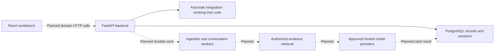

# Studying DocWeave from the beginning

Prepared on 2026-10-30, Asia/Calcutta. Reader: comfortable with Python and JavaScript; learning the architecture, unfamiliar tools, and engineering decisions.

This is a learning companion, not a replacement for the product specification or an implementation plan. [The inventory](study-inventory.md) records the files, dependency declarations, resolved package records, and Git changes inspected for this guide. Existing code was not changed to prepare it.

Path update — 2026-10-31: the guide and inventory below retain their historical snapshots. The live implementation now uses technical layers and separate RAG stages; use [README's current map](../README.md#repository-structure) and [architecture boundaries](architecture.md#code-organization--2026-10-31) to locate the equivalent code. Main, worker and evaluation commands remain stable.

## What we are studying

There are three useful views of this repository:

1. **Product intent:** what the completed application must do, described in the PRD and architecture.
2. **Saved implementation:** the exact files in each Git commit.
3. **Working implementation:** saved files plus the current uncommitted edits and new files.

The working tree is being edited. At inspection it included backend authentication, Keycloak configuration, a second migration, and a simplified frontend. Older README/status text and the original workbench plan describe earlier checkpoints. Treat their test counts as historical evidence for those checkpoints. This study session did not rerun the application suites or verify the new authentication work.

No private `.env`, credentials, database contents, or unrelated files are part of the study inventory. We study configuration names and placeholders through `.env.example`.

## How each lesson works

For each lesson we will:

1. Identify the problem and the behavior needed.
2. Explain the unfamiliar concepts and dependencies at that boundary.
3. Read the relevant document and actual code together.
4. Trace an input through the system, including an error path.
5. Read the test that supports the claim and state what it cannot establish.
6. Finish with a small prediction, explanation, or safe experiment.

No need to memorize syntax already familiar from Python or JavaScript. Completion means being able to explain the behavior and diagnose a failure. The units below are a reading sequence; none has been marked learned on your behalf.

## The product and its boundaries

DocWeave is intended to help an engineer answer a question using the project's goal, stack, approved documentation, and authorized private knowledge, while preserving inspectable citations and conversation history.



The frontend currently renders synthetic example content. A citation click follows local fixture and URL state; it does not demonstrate retrieval. The database foundation supplies records and database access boundaries; the complete application policy and workflows require more work. Authentication code is now present in the working tree, with verification still to be assessed in its own lesson.

## The history we can actually reconstruct

| Checkpoint | Local commit date | Contents to study |
| --- | --- | --- |
| `c7f1f4d` | 2026-10-28 | Planning documents, folder boundaries, ignore rules, empty Python dependency declaration, React/Vite starter, initial frontend dependencies. |
| `d120bdc` | 2026-10-29 | Draft OpenAPI contract, API guide, and links/status updates. Contract design precedes backend feature behavior. |
| `d43cba2` | 2026-10-29 | API skeleton and tests, PostgreSQL/pgvector foundation and tests, migrations/runbook, workbench and browser tests, dependency additions. Its title mentions frontend components but the commit contains these other changes too. |
| Uncommitted working tree | Inspected 2026-10-30 | Auth implementation/configuration/tests and current frontend changes. The inventory identifies each changed and new file. |

The initial commit already contains substantial planning. Git does not show every earlier edit or conversation. `memory.md` records a narrative, and the slice plans record claimed test-first sequences and review fixes; neither creates missing Git checkpoints. We can compare every saved revision and the current diff, but cannot reconstruct overwritten intermediate states from Git alone.

Read-only history commands, from the repository root:

```powershell
git log --reverse --stat
git show c7f1f4d:frontend/src/app/App.tsx
git diff c7f1f4d d120bdc -- backend/openapi.yaml docs/api.md
git diff d120bdc d43cba2 -- backend/src backend/tests
git diff d120bdc d43cba2 -- frontend
git diff -- backend frontend compose.yaml .env.example
git ls-files --others --exclude-standard
```

`git diff` does not display the contents of new untracked files. Read those separately. `git show` reads a historical file without replacing the current checkout.

## Complete reading sequence

| Unit | Topic and material | What you should be able to explain afterward |
| --- | --- | --- |
| 1 | Product purpose and first scaffold: `README.md`, `docs/PRD.md`; initial commit's `App.tsx`, `main.tsx`, `pyproject.toml`, and `package.json`. | What the user wants, what existed first, and the difference between product intent and working behavior. |
| 2 | Specification ownership: all of `docs/PRD.md`, `rules.md`, `memory.md`, and `tasks.md`. | Which document answers which question; confirmed requirements versus narrative history, constraints, tasks, and test evidence. |
| 3 | Architecture: all sections of `docs/architecture.md`, from runtime and tenancy through memory, jobs, budgets, evaluation, and the 29-source catalog. | The intended end-to-end flow, trust boundaries, data ownership, and which services remain planned. |
| 4 | Frontend design: all of `docs/design.md`, including every app flow and verification section. | How evidence, responsive behavior, accessibility, asynchronous states, and themes support the product. Compare older design details with the current UI. |
| 5 | Repository and toolchain: root config, manifests/locks, Vite, TypeScript, Oxlint, shadcn configuration, package scripts. | Source versus generated files; package manager versus runtime versus framework; how a local development server differs from a production build. |
| 6 | API design: `backend/openapi.yaml`, `docs/api.md`, `test_openapi.py`; compare `d120bdc` with later revisions. | Paths, methods, operation IDs, request/response schemas, references, security declarations, examples, and the limits of schema checks. Walk through every operation group. |
| 7 | API runtime: API-skeleton plan, `routes.py`, `main.py`, `conftest.py`, `test_health.py`, and `test_api.py`. Begin with the committed skeleton, then inspect the auth-era diff. | ASGI server versus app, app factory, middleware, safe errors, dependencies, liveness/readiness, reserved routes, and in-process HTTP testing. |
| 8 | Relational records: `models.py` and `0001_core.py`. | Users/workspaces/memberships/projects, primary/foreign/composite keys, constraints, defaults, JSONB, UTC timestamps, ORM metadata versus actual database schema. |
| 9 | Local services and migration lifecycle: database plan/runbook, Compose, bootstrap shell, Alembic config/environment/template. | Container image/tag/digest, host/container networking, named volume versus tmpfs, bootstrap versus migration, admin/migrator/runtime roles, and explicit schema upgrades. |
| 10 | Tenant isolation and transactions: `db.py`, `settings.py`, core migration policies, every database test. | Parameter binding, transaction-local identity context, membership-backed RLS, pooling cleanup, commit/rollback, privilege limits, and destructive-test target guards. |
| 11 | Authentication design/configuration: auth plan, `.env.example`, auth Compose profile, Keycloak realm, `AuthSettings`, `make_oidc`, auth models, `0002_auth.py`. | Identity provider versus application session; issuer/subject versus email; OIDC, PKCE, state, nonce, tokens, cookie flags, hashing/encryption, CSRF, and narrowly granted identity provisioning. |
| 12 | Authentication execution/evidence: all of `auth.py`, changes in `main.py`, `test_auth.py`, and `smoke_auth.py` if present in the inventory. | Login -> callback -> app session -> `/me` -> logout, denial/expiry/replay/rate limits, mock versus live identity evidence, and what remains unverified. Read smoke code before considering execution. |
| 13 | Frontend startup/themes: `index.html`, `main.tsx`, `App.tsx`, global CSS, theme/media hooks. | Browser startup, React root/StrictMode, CSS tokens/utilities, theme before first render, OS preference, storage failure, and event-listener cleanup. |
| 14 | UI primitives: all six `components/ui` files, their imports, and `components.json`; current suggestions component if present. | What local shadcn source supplies, what Radix supplies, class/variant composition, props, refs, composition, focus, and accessible names. |
| 15 | Original workbench: workbench slice plan and frontend files at `d43cba2`, with their original browser tests. | State ownership, synthetic sources, composer, evidence inspection, URLs, history, dirty drafts, clipboard handling, provider selection, and responsive sheets. |
| 16 | Current frontend changes: compare each modified frontend file with `d43cba2`; read current `sample.ts`, `Workbench`, composer, sample answer, inspector, suggestions, and both browser suites. | What changed, which state moved, current entry/default view, workspace/chat URLs, draft preservation, sidebar/source behavior, and what remains a preview. |
| 17 | Every dependency: the direct-dependency roles below and every row in the inventory, including transitive edges, extras, markers, optional packages, and native platform variants. | Why a package is present, who requires it, what runs in the browser/server/build/test process, and declared range versus resolved version. |
| 18 | Evidence, gaps, and release sequence: revisit all slice evidence, tests, task milestones, placeholder directories, and operational instructions. | A defensible account of what has been built, what has been tested historically, what needs re-verification, and how Tasks 1–12 reach the intended release. |

For Units 3, 4, and 6, split the larger files by their existing headings. Each heading or API domain can be a separate lesson. For Units 7–16, read every function and test, rather than stopping after the highlighted symbols.

## Every document has a different job

| Document | Reading question |
| --- | --- |
| Root `README.md` | Where is everything, what was reported as implemented, and how is it intended to run? |
| `PRD.md` | Who is this for, what must the finished product do, and what is outside scope? |
| `architecture.md` | How should identity, data, jobs, retrieval, memory, providers, budgets, privacy, and operations fit together? |
| `design.md` | What should each screen, flow, responsive layout, theme, error, and accessible interaction do? |
| `rules.md` | What engineering/privacy/reliability constraints must every change preserve? |
| `tasks.md` | In what order should the confirmed release be implemented and demonstrated? |
| `memory.md` | What decisions and work were recorded across sessions? Which notes describe an earlier state? |
| `api.md` and `backend/openapi.yaml` | How are the planned wire contracts explained and specified, and where does runtime behavior differ? |
| `runbooks/database.md` | How are local databases operated, migrated, tested, stopped, and recovered without losing development data? |
| `2026-10-29-api-skeleton.md` | What was authorized and tested in the HTTP skeleton slice? |
| `2026-10-29-database-foundation.md` | What database boundaries were built, what failures were found, and what evidence was recorded? |
| `2026-10-29-workbench.md` | What did the original UI slice intend and verify, before the current redesign? |
| `2026-10-30-auth.md` | What is the scope of the ongoing auth slice and which verification steps remain unchecked? |
| This guide and `study-inventory.md` | What will we study and what source snapshot does the coverage refer to? |

The PRD links an original brief outside this repository. That reference is historical provenance; this guide does not assume the external file is available or claim to have reviewed it.

## Dependency study method

The manifests declare acceptable requirements. The lockfiles record resolved packages, relationships, and distribution metadata. A lockfile entry does not mean that package is installed here or selected on every platform. A package can be directly imported by our source while entering the environment transitively; Pydantic and Starlette are examples in the API code. Python's standard library and browser APIs do not appear as npm/Python package requirements.

For each package ask: Who chose it? Which file uses it? What behavior would fail without it? Is it runtime, build, test, or an optional/platform-specific edge? The inventory has exact declaration strings and resolved versions, so this guide does not duplicate those numbers.

| Backend declaration | Role in this project |
| --- | --- |
| `fastapi` | HTTP application, routing, request dependencies, and response models. Study its Pydantic/Starlette dependencies alongside actual imports. |
| `uvicorn` | Command-line ASGI server that hosts the FastAPI app. |
| `sqlalchemy[asyncio]` | Relational models, SQL execution, asynchronous engines/sessions, and transaction boundaries. The bracket requests an extra dependency group. |
| `asyncpg` | PostgreSQL driver selected by `postgresql+asyncpg` URLs. |
| `alembic` | Versioned schema migration execution; `0001_core` and `0002_auth` are application migration source. |
| `python-dotenv` | Read local configuration values from `.env` without publishing their contents. |
| `authlib` | OIDC client construction and authentication protocol handling in the auth work. |
| `cryptography` | Fernet encryption of retained authentication material in the auth work. |
| `httpx2` | HTTP client transport exercised by the auth provider mock. Trace its adapter use through `make_oidc` and `test_auth.py`; it is a distinct locked package from `httpx`. |
| `pytest` (dev) | Test discovery, fixtures, parameterized cases, and assertions. |
| `anyio` (dev) | Async test integration; the fixture selects the asyncio backend. |
| `httpx` (dev) | In-process ASGI requests in tests and HTTP requests in the auth smoke helper. |
| `jsonschema[format]` (dev) | Validate example payloads against draft schemas, including format support. |
| `openapi-spec-validator` (dev) | Validate the draft API document's specification structure. |

| Frontend declaration | Role in this project |
| --- | --- |
| `react` | Components, state, effects, refs, and render behavior. |
| `react-dom` | Attach the React component tree to the browser DOM. |
| `radix-ui` | Primitives used by local dialog/sheet/select/slot components. |
| `class-variance-authority` | Named class variants for controls such as buttons and badges. |
| `cn` | Class composition used by the local UI components. |
| `lucide-react` | Icon components used by the workbench and controls. |
| `vite` (dev) | Development server and frontend build command. |
| `@vitejs/plugin-react` (dev) | React integration configured in Vite. |
| `typescript` (dev) | Type checking/project builds invoked before Vite's production build. |
| `@types/react` (dev) | React type declarations used by TypeScript. |
| `@types/react-dom` (dev) | React DOM type declarations used by TypeScript. |
| `@types/node` (dev) | Node type declarations for tooling/configuration such as `node:url`. |
| `tailwindcss` (dev) | Utility styling and theme token integration. Generated CSS is used by the browser. |
| `@tailwindcss/vite` (dev) | Tailwind's configured Vite build integration. |
| `tw-animate-css` (dev) | Animation stylesheet imported by global CSS. |
| `oxlint` (dev) | Static lint checks, including the configured hook rules. |
| `@playwright/test` (dev) | Browser interaction tests, assertions, local web-server setup, and traces. |
| `@axe-core/playwright` (dev) | Automated accessibility checks inside browser tests; these do not establish complete accessibility. |

Also study the platform dependencies: Python, Node.js, uv, npm, Git, Docker/Compose, PostgreSQL, the pgvector extension/container image, Keycloak, and Mailpit. shadcn components are local source files here; shadcn is not a runtime package entry in `package.json`. The suggestions file identifies its source adaptation in a comment; assess that attribution from the file, without assuming a new package was installed.

Architecture references to LangGraph, LangChain, Procrastinate, hosted model integrations, and observability are future design commitments unless actual implementation/dependencies demonstrate otherwise. A transitive `opentelemetry-api` record alone does not establish application telemetry.

## First lesson: why the repository started this way

### The problem

A generic answer does not automatically know the project's goal, selected stack/version, private constraints, or which evidence its author may access. DocWeave's intended answer must be grounded in the authorized project context and inspectable sources. This is why the planning covers ingestion, identity, versioned sources, conversation state, provider approvals, spending, and recovery as well as the chat screen.

Consider two workspaces that both have a document called `deployment.md`. The document title is insufficient to select evidence. The application must establish the current user and authorized workspace/project/resources, then select permitted evidence. An opaque document ID and a visible sidebar selection do not establish permission. This requirement will later explain the backend policy boundary, membership tables, RLS, and checks before releasing a result.

### The first runnable screen

At `c7f1f4d`, `App.tsx` contained only a main element with the DocWeave heading and a short description. The backend manifest had `dependencies = []`. There was no backend runtime or AI pipeline in that checkpoint. The frontend package manifest declared React/React DOM plus the starter build/type/lint toolchain.

Trace that initial browser page:

```text
frontend/index.html
  -> module script /src/app/main.tsx
  -> global.css import
  -> createRoot(document.getElementById('root'))
  -> <StrictMode><App /></StrictMode>
  -> heading and description in the page
```

`index.html` supplies the root element. `main.tsx` mounts the application. `App.tsx` supplies the first component. CSS controls presentation. Vite is configured to process the React frontend; the TypeScript and lint configurations check different kinds of mistakes. None of this trace reaches a model or database.

The current `App.tsx` delegates to `Workbench`. That is a later implementation. We use historical reads to understand the small first step, then compare the later changes rather than pretending the current complexity existed from the start.

### Why separate frontend and backend roots?

The frontend owns browser interactions and presentation; the backend owns identity/policy, durable data, retrieval, external processing, and budgets. Their intended boundary is HTTP. The initial folder layout expressed ownership before all those behaviors existed. Empty `.gitkeep` files retain directories in Git; they are not implementations.

The separate dependency manifests also reflect separate execution environments. npm manages the frontend graph; uv manages the Python graph. Docker Compose describes supporting services. A dependency on React is a package requirement; a dependency on a running PostgreSQL service is an operational requirement. We study both.

### Requirements versus evidence

The PRD defines the destination. The architecture defines intended system behavior. The design describes frontend flows. The task plan sequences implementation. Source code describes what a given revision actually attempts. Executed tests support particular claims at a particular revision/environment.

For example, validating the OpenAPI schema can show that a declared request schema rejects a malformed example. It cannot show that a running endpoint enforces membership. An example answer with three source buttons can demonstrate UI navigation. It cannot show that retrieval found three real documents.

### Your first checkpoint

Explain these in your own words before moving to Unit 2:

1. What does DocWeave add to a basic chat screen?
2. Which files made the initial frontend render, and where would a database request have appeared if one existed?
3. Why does neither a workspace selector nor a document ID prove access?
4. Which document would you consult for a product requirement, an implementation mechanism, and a recorded verification result?

Next: read the initial PRD and rules against the current versions, identify the accepted requirements, and map each document's responsibility before taking on the larger architecture.

## Verification of this learning material

The inventory was generated from Git's tracked/nonignored file list, manifests, and lockfiles. It includes source digests to identify the inspected content and complete dependency-edge tables. Local document links and inventory coverage were checked when this guide was prepared. The graph describes lockfile records, not an installation audit or security audit.

Not checked here: live identity/provider flows, current test-suite outcomes, browser rendering, package internals, or private runtime configuration. Some working-tree files may change while another task continues; recheck their diff before studying the final implementation.
